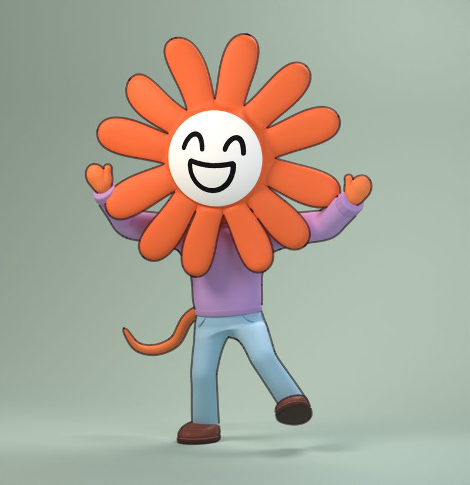

# Claudesona rig (Blender)

`Claudesona.blend` is the rigged, poseable 3D Claudesona. It is the source of the rendered
emotion sprites that the Claudesona image model was first trained on, and through that model of
the Claudemoji in this extension: 80 of the 93 training sprites are renders of this puppet (the
other 13 are the original flat sprites in `chrome-extension/assets/claude_*.png`).

Open it in Blender 4.0 or newer. Keep `blender_assets.cats.txt` beside it: that file names the
catalogs the pose library is sorted into.

## What is in the file

- **The character:** 110 mesh parts on a 60-bone skeleton, `Claudesona | Performance Rig`. Hands and
  feet are IK controls; hips, chest, head, thumbs, six tail joints and every petal can be moved.
- **The face:** four controls beside the flower named Eyes, Brows, Mouth and Bloom, with sliders
  in Bone Properties > Custom Properties (lid shapes and gaze, brow lift and tilt, mouth curve /
  open / round / teeth / tremble, petal droop and flutter, blush). They are native Blender drivers
  and work with script auto-execution disabled.
- **A pose library of 213 poses:** two full-character poses for each of 100 emotion words
  (`Emotion · Word` and `Variant · Word`, sorted into Anger, Fear, Joy, Love, Sadness and Surprise)
  plus the 13 original emotes.
- **A short animation,** "A little hello" (frames 1 to 164 at 24 fps; press Space).
- **A studio scene** set up for Cycles with three cameras and three lights.
- **Two text blocks** in the Text Editor: `START HERE · Claudesona`, the full manual, and
  `EMOTION INDEX`, the 100 words with the acting direction behind each pose.

## Posing it

1. Select `Claudesona | Performance Rig` and enter Pose Mode.
2. To apply a whole pose, clear the bone selection (Alt+A) and double-click a thumbnail in the
   pose shelf or the Asset Browser (Current File). With only Eyes, Brows or Mouth selected, the
   same double-click borrows just that part of the pose.
3. To pose by hand, move the hand and foot controls with G and rotate them with R.

To make sprites like the training set, render with a transparent or plain green background and
key the green out afterwards.

## What is not here

Half of the 80 rendered training sprites came from this pose library. The other half were chosen
from a larger audition file with six takes per word (600 poses, 52 MB), which is not included.

## Credits

Original Claudesona fan art by [thebes](https://github.com/vgel), derived from the Anthropic logo.
The rig was traced from the 13 sprites in this repository (revision `b53d058`). This is an
unofficial fan project and is not affiliated with Anthropic.
